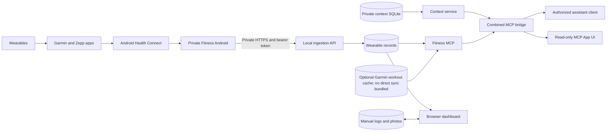

# Private Fitness

An end-to-end, self-hosted fitness project: an Android Health Connect bridge, authenticated ingestion, source-aware storage and queries, a Garmin workout-cache schema with read-only tools, a personal-context service, MCP servers, and two dashboard interfaces.

This is the source for a portfolio project by [David Villero](https://github.com/DavidVillero). It contains no real measurements, meals, plans, conversations, credentials, databases, screenshots, APKs, signing keys, or private host identifiers. Test inputs are artificial and created in temporary stores. Configuration examples contain dummy values; setup generates new credentials locally.

Engineering status: **reviewed source with outstanding deployment checks**. The [engineering review](docs/engineering-review.md) records fixes and verification. [Security status](docs/security-status.md) records upstream OS advisories; [development](docs/development.md) provides repeatable checks. No production certification is claimed. See the [release acceptance record](docs/release-readiness.md) for completed checks and remaining gates.

## Components

| Component | Source | Role |
| --- | --- | --- |
| Android app 0.6.2 / versionCode 8 | `services/private-fitness-mcp/android/` | Reads Garmin/Zepp Health Connect records; encrypted token storage, durable outbox, upload checkpoints, optional hourly WorkManager sync |
| Fitness backend | `services/private-fitness-mcp/fitness/` | Validation, idempotent imports, SQLite/MySQL storage, coverage and source selection |
| Garmin workout cache | `fitness/garmin_workouts.py` in that service | Read-only tools over an optional workout-detail cache, kept separate from Health Connect totals. No sync adapter is included; see [phone and sources](docs/phone-and-sources.md). |
| Personal context | `services/personal-context/` | Local plans, meal logs, notes, files, revision history, scope-controlled tools, backup and restore |
| MCP and bridge | `fitness/mcp_server.py`, `context_service/mcp.py`, `services/chatgpt-mcp/dashboard.py` | Fitness-only, combined, and dashboard-capable stdio entry points |
| Browser dashboard | `app.py`, `static/` | Private web interface with separate manual-log tables and photo storage |
| MCP App dashboard | `apps/chatgpt-dashboard/` | Read-only embedded UI; MCP Apps and ChatGPT host adapters; synthetic Chromium checks, live-host acceptance pending |
| Deployment | `scripts/`, `deploy/`, `config/` | Fresh-install generator, Compose, launchers, and dummy client/job templates |

## Architecture and data flow



Detailed diagrams and boundaries: [architecture](docs/architecture.md) and [data flow](docs/data-flow.md).

## Setup

Follow [end-to-end setup](docs/setup.md) in a **new checkout**, using your own local configuration. It covers Python, empty MySQL schemas, the ingestion API, context service, browser dashboard, and MCP launchers. Continue with [Android, Garmin and Zepp](docs/phone-and-sources.md), then [assistant clients and optional tunnel](docs/mcp-clients.md).

Quick source-only tests using Python 3.12 or 3.13, with no accounts or running database server:

```sh
python3 -m venv .venv
. .venv/bin/activate
python -m pip install --require-hashes --only-binary=:all: -r requirements-dev.lock
python -m pytest -q
```

No direct Garmin login/sync adapter ships with this candidate. A MySQL integration test is opt-in and refuses non-test schema names. See [validation](docs/validation.md) for what was and was not exercised for this export.

## Privacy and limitations

Local storage does not mean that vendor apps or assistant providers never receive data. Garmin/Zepp perform their own synchronization with their vendors. Authorizing an assistant to call tools shares the returned values with that client/provider. The embedded dashboard itself has no external fetches or analytics.

Additive interval totals select the source with greater observed record coverage rather than assuming the first source with data is complete. Coverage still does not prove watch wear or export completeness. Expired Health Connect tokens trigger a 30-day reread with a persistent warning: missed deletions may remain unreconciled. Source selection and recovery flags are conservative heuristics, not validated clinical or readiness models. Missing records are unknown. Cached Garmin workout details are not added to Health Connect totals. The browser's manual logs and the context service's meals are separate stores.

The 0.6.2/code 8 candidate was installed in place over 0.6.0/code 6 on one Android 17 device using its original signing identity. Pairing and queued state were preserved, and live upload acknowledgments advanced. Full sync completion, reboot/background lifecycle and other device combinations remain unverified. Private installation state and signing keys are not distributed. See [release scope](docs/release-scope.md), [operations](docs/operations.md), and [dependencies](docs/dependencies.md).

## Author, rights and collaboration

Created by [David Villero](https://github.com/DavidVillero) with AI-assisted implementation. Read the [implementation case study](docs/public-write-up.md) for the engineering decisions behind the project. For engineering opportunities, integration discussions or licensing enquiries, contact the author through the public GitHub profile or open a non-sensitive discussion issue. Never post health records, credentials or private logs in issues.

Copyright © 2026 David Villero, to the extent of copyrightable contributions owned by the author. All rights reserved. **No open-source or other project-code license is granted.** See the rights notice for viewing, forking and licensing details. Third-party components retain their own licenses, and statutory exceptions remain unaffected. See [rights and vendor boundaries](docs/rights-and-vendors.md).

This is an independent project, not affiliated with, endorsed by or approved by Garmin, Google, Zepp or OpenAI. Their names identify external integrations only. No direct Garmin sync adapter is included. Publishing this code does not establish permission to use vendor services.
