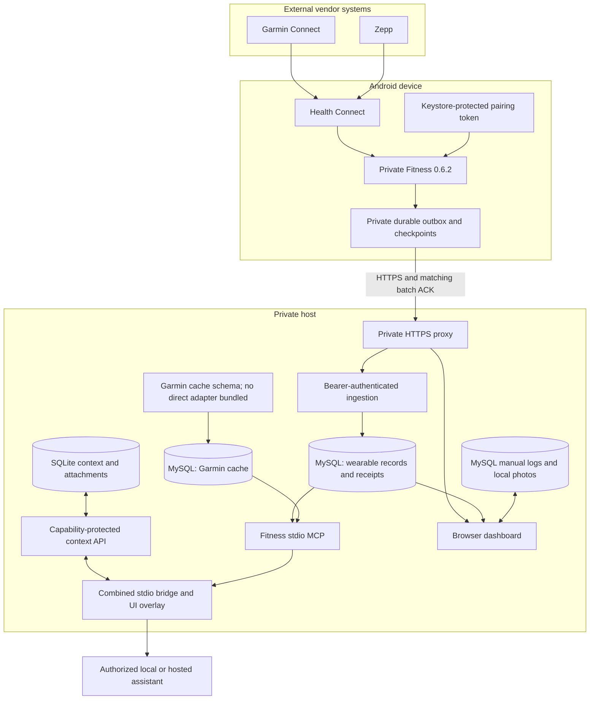

# Architecture and trust boundaries

The phone receives only an ingestion capability, never database credentials. Host-side SQL separates writer, reader, Garmin-sync and browser-log roles. Context uses separate read/write capability files. Stdio client configs reference launchers rather than tokens.

MySQL is bound to host loopback for host services. The browser connects over the Compose network using its limited roles. Ingestion/context bind loopback; only selected ingestion/browser routes are exposed through private HTTPS. Same-user host processes remain inside the trust boundary. Local files and Compose secrets are not an encrypted secret manager.

An assistant tool call is an outbound disclosure of returned data to that client. The optional hosted tunnel is outside this repository's ownership and is not bundled. Authentication does not mean a hosted provider sees no health data.

The two dashboards intentionally have different data stores: the browser owns manual logs/photos, while the MCP UI reads context meals/plans. No silent reconciliation connects those stores. The direct Garmin cache also remains separate from daily Health Connect metrics.
