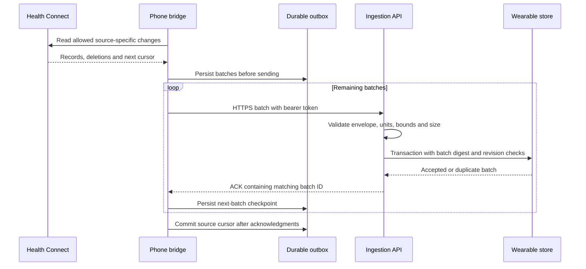
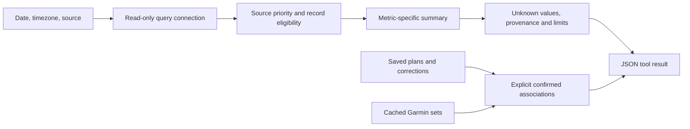
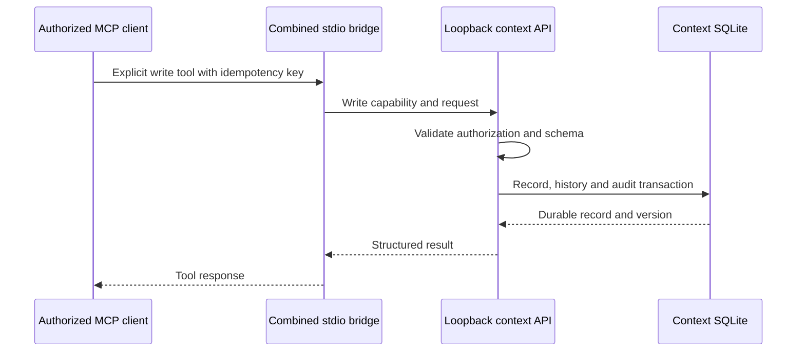

# Data flow and persistence

Reusing a batch ID with different content is rejected. Revisions update records only when newer; deletion tombstones prevent old retries from resurrecting records. Interrupted uploads keep queue state. Each source stream commits independently. A completion receipt records delivery, not complete wear/export coverage.

Daily metrics choose sources per metric. Additive interval totals (steps, distance and calories) prefer greatest observed record duration, breaking ties by configured source priority; other interval metrics retain the relative-coverage rule and point metrics retain presence priority. Observed time does **not** establish wear or export completeness. Results include per-source observed fractions and flag steps excluded at midnight boundaries. Activity queries rank recordings per workout. Same-source overlaps are excluded and substantial cross-source overlap uses an 80-percent heuristic. Source comparisons are unpaired daily summaries. Unknown measurements are never invented from other sensor types.

Recovery queries include the requested end date. The dashboards request the previous day for recovery; scheduled reports currently use their report day. Choose a completed end date when avoiding an ongoing day matters. Optional user profiles are loaded only from an explicitly configured local file; no profile is supplied.

Context content remains data, not executable instructions. Backup/restore includes versions and linked attachment bytes; soft deletion retains history and old backups. Physical retention cleanup is a separate operator action.
